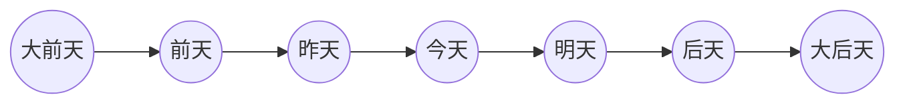
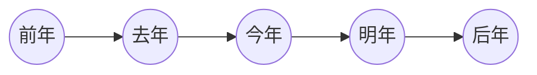
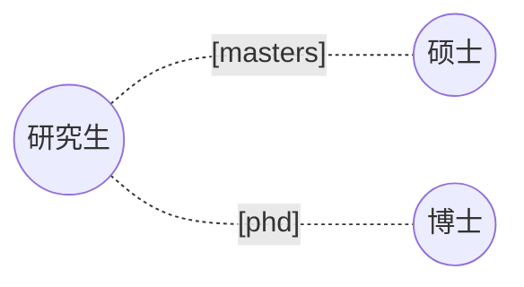

日期: 2025年02月08日
***
## 词语
#Q 
Anteayer :: 前天 (qián tiān)
Pasado mañana :: 后天 (hòu tiān)
Guía de turista :: 导游 (dǎo yóu)
Estudiante de posgrado :: 研究生 (yán jiū shēng)
Trabajar de medio tiempo :: 打工 (dǎ gōng)
Hacer uso de, utilizar (con un fin concreto) :: 利用 (lì yòng)
Vacaciones :: 假期 (jià qī)
Agencia de viajes :: 旅行社 (lǚ xíng shè)
Organizar, organización :: 组织 (zǔ zhī)
Jefe :: 老板 (lǎo bǎn)
Necesitar, necesidad :: 需要 (xū yào)
Usualmente, generalmente :: 经常 (jīng cháng)
Recolectar :: 收集 (shōu jí)
Tan pronto como :: 一……就…… (yī……jiù……)
Planificar, plan :: 安排 (ān pái)
Ayudar, ayuda :: 帮助 (bāng zhù)
Ayudar :: 帮 (bāng)
Tener esperanza, esperanza :: 希望 (xī wàng)
Ferrocarril :: 铁路 (tiě lù)
Paisaje, vista escénica :: 风光 (feng)
Consultar, discutir, hablar de :: 商量 (shāng liang)
Lugar de nacimiento, pueblo de origen :: 故乡 (gù xiāng)
Libre, libertad :: 自由 (zì yóu)
Actividad, ejercitarse :: 活动 (huó dòng)
Mutuo :: 互相 (hù xiāng)
Extranjero :: 老外 (lǎo wài)
Nariz :: 鼻子 (bí zi)
Pelo :: 头发 (tóu fa)
Ojo :: 眼睛 (yǎn jing)
Tono de chino :: 声调 (shēn diào)
Shenzhen :: 深圳 (shēn zhèn)

## 时间词汇



## 研究生种类


## 语法
### 1. 语法点
#### 特点
在这里写。

#### 语法
在这里写。

#### 例如
- 第一例如。
- 第二例如。

## 闪卡
```aosr-deck-config
{
	"rule": {
		"conditions": {
			"all": [{
				"fact": "card",
				"operator": "regexMatch",
				"value": "Chinese/HSK4/汉语教程/第六课：我是跟旅游团一起来的.md",
				"path": "$.path"
			}]
		},
		"event": {
			"type": "match"
		}
	}
}
```
