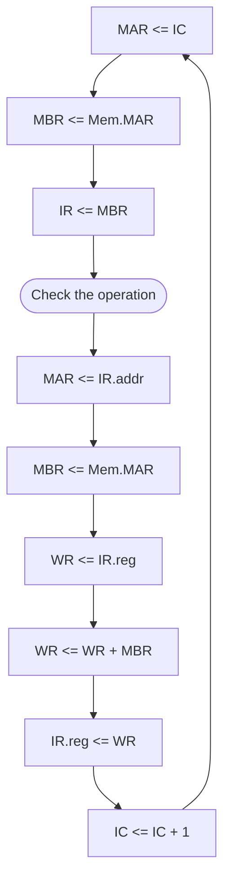

---
tags:
  - machine-structure
  - assembler
  - machine-language
  - von-neumann-architecture
---
Date: 2024-06-26 : 08:44
***
## Introduction
![[fig2.1.png|400]]

All modern computers are based on the **stored program computer**, created by **von-Neumann**.

The parts that make it up are:
- **Instruction Interpreter:** Does instructions based on memory.
- **Location or Instruction Counter:** Location of instruction executed.
- **Working Registers**: Used by the instruction interpreter.
- **General Registers:** Used by the programmer.
- **Memory Address Registry (MAR):** Address of memory to read or write.
- **Memory Buffer Registry (MBR):** Copies that that was read or is going to be written on the MAR.
- **Memory Controller:** Manages flow of data going to and from the RAM.
- **I/O Channels:** Can be thought of as different computers that interpret instructions to I/O to memory.

The main idea behind assembly language is the following:

| Operation code | Register number | Memory Location (addr.) |

```asm
ADD 2,176
```

This would *add* the value of *memory addr. 176*, to the *register 2*.
## 2.1.1 General Approach to a New Machine
General flow of **cpu**. Consider the  instruction `ADD 2,176`.



## 2.1.2 Machine Structure 360 and 370

- Value

## Introduction

- Value