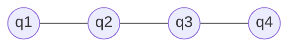

---
tags:
  - markov-network
---
Date: 2026-10-29 : 17:26
***
## Definition
### Random Field
A collection of $s$ random variables, $F = F_{1}, \dots, F_{s}$ **indexed by sites**.

### Markov Random Field (Markov Network)
A Markov Network (also called Markov Random Field) is a random field who satisfies the **locality property**, that is, it is only influenced by its neigbors.

A Markov Network is an **undirected graph** whose vertices are random variables and their probability is dependent of their neighbors (the edges). 

Lets say the random variables are: $\mathbf{X} = X_{1}, \dots, X_{n}$, then the locality property is:
$$
P(X_{i} | X_{1}, \dots, X_{i-1}, X_{i+1}, \dots, X_{n}) =P(X_{i} | Nei(X_{i}))
$$

Example:
For the following Markov Network, because of the localityb property:
$$
P(q_{1} | q_{2}, q_{3}, q_{4}) = P(q_{1} | q_{2}) \quad \text{Because only $q_2$ is neigbor}
$$

## Types of Markov Networks
Two types:
- Regular: A lattice.
- Irregular: Not a lattice.