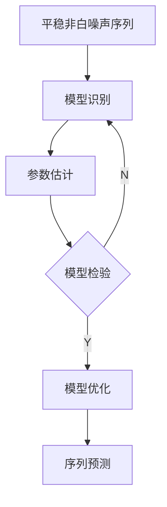

---
tags:
---
Date: 2026-09-16 : 20:28
***
## 预测任务
#Q  #AOSR/d25e7
- 时序（预测）有6个任务，它们是 :: 输入、变量、输出、模型作用范围、适配（adaptation）、时间范围 #AOSR/d25e7/s/59bs

## 时间序列分析的目标
#Q  #AOSR/5m4fr
- 截至（jié zhì，up to）时刻t可以获得的历史信息是 :: $y_{t - L + 1 : t}, x_{t - L + 1}^{past}$ #AOSR/5m4fr/s/535q
- 未来已知消息是 :: $x_{t - L + 1: t + H}^{known}$ #AOSR/5m4fr/s/3lki
- 静态（static）信息 :: $c$ #AOSR/5m4fr/s/z776
- 定义$F_{t} = \{ y_{t - L + 1 : t}, x_{t - L + 1}^{past}, x_{t - L + 1: t + H}^{known}, c \}$是时刻t所有可以获得的消息，时序（sequential timing）预测目标为构建（construct） :: $p(Y_{t - L + 1: t + H}|F_{t})$ #AOSR/5m4fr/s/4cgc

## 时间序列分析和回归（regression）
#Q  #AOSR/37rl7
- 监督学习常假定样本（sample）是 :: 独立/可交换（exchangeable）的。 #AOSR/37rl7/s/75e1
- 时序显式（explicitly）利用 :: 依赖（dependence） #AOSR/37rl7/s/62v9
- 监督学习和时间序列分析在某些方面有相似处，比如说间序列分析也可以使用... 进行... :: 最小二乘方法（least squares method），参数（parameter）估计。 #AOSR/37rl7/s/45fk

## 时间让普通学习问题发生变化
#Q  #AOSR/3aph0
- 时序预测有3个重点的特点 :: Temporal Dependency, Time Direction & Distribution Change #AOSR/3aph0/s/66q1
- Temporal Dependency的意思就是过去可能包含关于...信息 :: 未来 #AOSR/3aph0/s/74gd
- Time Direction的意思是未来数据不能反过来帮助 :: 过去的预测。 #AOSR/3aph0/s/1l82
- Distribution Change就是序列的...、...、...可能随时间变化 :: 水平，趋势（qū shì；trend），波动规律（bō dòng guī lǜ；fluctuation laws） #AOSR/3aph0/s/38d7

## 时间序列与传统机器学习的假设（hypothesis）
### 监督学习
#Q  #AOSR/1ht5n
- 给定示例（give a demonstration）（属性（attributes））$x_{1}, x_{2}, \dots,x_{n}$以及对应的标记（labels）$y_{1}, y_{2}, \dots,y_{n}$需要学习示例到……，目标公式…… :: 标记映射，$\hat{y} = f(x)$ #AOSR/1ht5n/s/2en0
- 假设样本有两个特点 :: 独立和同分布（i.i.d）。 #AOSR/1ht5n/s/4cf5

### 时间序列
#Q  #AOSR/28tei
- 样本之间存在什么样的关系？ :: 依赖关系。 #AOSR/28tei/s/7i1h
- 后续样本依赖什么？ :: 以往（past）样本。 #AOSR/28tei/s/4j45
- 基于（jī yú；on account of）不同的上下文属性有不同的什么？ :: 概率假设 #AOSR/28tei/s/172n
- 如果我们忽略（hū lüè；ignore）依赖关系的话，就转化为……问题（假设信息是……） :: 回归，独立和同分布的。 #AOSR/28tei/s/5g4p

## 时间序列的三种观察（guān chá；observe）方式
#Q  #AOSR/46v36
- 目前时间序列的3种观察是：a) 统计（tǒng jì；statistical）建模（model building）：时域视角。b）统计建模：频域视角。c）数据驱动（qū dòng；driven）：机器学习视角。
- 统计建模：时域视角重视两个方面 :: 依赖结构（今天和昨天有多大的关系）与随机过程。 #AOSR/46v36/s/7os6
- 统计建模：频域视角重视 :: 不同的频率（pín lǜ；frequency）成分。 #AOSR/46v36/s/5jk1
- 数据驱动：机器学习视角能够从数据学习什么？ :: 预测映射。 #AOSR/46v36/s/4n1l
- 目前模型用什么视角？ :: 目前模型往往**融合**3种观察。 #AOSR/46v36/s/1gme

## 时间序列（预测）分析的建模视角
### 统计建模：时域视角
#Q  #AOSR/6hd6c
- 直接刻画（kè huà；characterize）不同时间点之间的什么？ :: 随机依赖。 #AOSR/6hd6c/s/55jt

### 统计建模：频域视角
#Q  #AOSR/59o9b
- 将时间变化分解为不同什么？:: 频率/尺度成分。 #AOSR/59o9b/s/6j3i

### 数据驱动：机器学习视角
#Q  #AOSR/27e8t
- 从历史数据中学习什么样的预测映射与表示 :: 非线性。 #AOSR/27e8t/s/19b4

## 时间序列预测（1）
### 输入
#Q  #AOSR/1kbch
- 截至时刻t可以获得的历史消息有两个变量 :: $y_{t-L+1:t}$ 和 $x_{t - L + 1:t}^{past}$ #AOSR/1kbch/s/j4aq
	- L表示谁的长度？ :: 历史窗口 #AOSR/1kbch/s/3vm0
	- $y_{t-L+1:t}$ 和 $x_{t - L + 1:t}^{past}$有什么区别？:: y是我们目标序列，x仅是历史可用协变量（covariates） #AOSR/1kbch/s/z698
- 未来已知消息是 :: $x_{t - L + 1:t+H}^{known}$ #AOSR/1kbch/s/1had
	- H表示谁的长度？:: 预测区间（forecast horizon） #AOSR/1kbch/s/2m0f
- 我们还有另一种消息 :: 静态信息c #AOSR/1kbch/s/4n77

### 学习
#Q  #AOSR/1p69p
- 用历史、变量关系和外部因素建啥模型？:: 预测模型$f_{\theta}$ #AOSR/1p69p/s/73rt

### 输出
#Q  #AOSR/2lnin
- 有2种预测 :: **点预测**$\hat{y}_{t+1:t+H|t}$或**概率预测**$p_{\theta}(Y_{t+1:t+H}| F_{t})$ #AOSR/2lnin/s/78rm
- $\hat{y}_{t+1:t+H|t}$叫做 :: 预测结果。 #AOSR/2lnin/s/igi9
- 我们最后的公式是 :: $\hat{y}_{t+1:t+H|t} = f_{\theta}(F_{t} = \{ y_{t - L + 1 : t}, x_{t - L + 1}^{past}, x_{t - L + 1: t + H}^{known}, c \})$ #AOSR/2lnin/s/71kd

## 时间序列预测（2）
### 点预测
#Q  #AOSR/328nv
- 条件分布的某个 :: 代表性函数 #AOSR/328nv/s/z546
- 公式 :: $\hat{y}_{t+h|t} = \mathbb{E}[Y_{t+h} | history, covariates]$ #AOSR/328nv/s/67ki
- 从条件分布中提取（retrieve）啥？ :: 一个值 #AOSR/328nv/s/aide

### 概率预测
#Q  #AOSR/7hgks
- 描述未来 :: 不确定性 #AOSR/7hgks/s/5v73
- 公式 :: $p(Y_{t+1 : t+H} | \text{history, covariates})$ #AOSR/7hgks/s/g3dg

## 时间序列的统计定义
### 随机序列（stochastic time series）
#Q  #AOSR/5srl8
- 按时间顺序排列的一组 :: 随机变量（$\cdots, Y_{1}, Y_{2},\cdots, Y_{n}, \cdots$） #AOSR/5srl8/s/5ptn

### 观察值序列（observed series）
#Q  #AOSR/s0lvj
- 随机序列的n个 :: 观察值（$y_{1}, y_{2}, \cdots, y_{n}$） #AOSR/s0lvj/s/4grp

### 随机序列和观察值序列
#Q  #AOSR/49ois
- 观察值序列是随机序列的一个 :: 实现（realization） #AOSR/49ois/s/421r
- 研究的目的是想揭示（jiē shì；reveal）什么？ :: 随机时序的性质（nature） #AOSR/49ois/s/6tjr
- 由观察值序列的性质来推断什么？:: 随机序列的性质。 #AOSR/49ois/s/4f9q

## 小麦价格序列例子
#Q  #AOSR/44sdl
- 给定$Y_{t}$，如何预测下一个月的价格？
	- 假定价格**不变化**那 :: $\hat{y}_{t+1|t} = y_{t}$  #AOSR/44sdl/s/4err
	- 那真实价格（$y_{t+q}$）和预测价格（$\hat{y}_{t+1|t}$）残差（cán chā；residual）为 :: $\epsilon_{t+1} = y_{t+1} - \hat{y}_{t+1|t}$。 #AOSR/44sdl/s/3tlv
	- 因为$\epsilon_{t+1} = y_{t+q} - \hat{y}_{t+1|t}$，所以$Y_{t}$和$Y_{t-1}$有什么关系？:: $Y_{t} = Y_{t+1} + \epsilon_{t}$ #AOSR/44sdl/s/4geb
- 这个问题有两个分析方法 :: 不稳定方法和稳定方法。 #AOSR/44sdl/s/3aet
- **不稳定**的方法是用$Y_{t} = Y_{t+1} + \epsilon_{t}$，问题是$\epsilon_{t}$是个互不相关的随机变量，也可以叫做 :: 白噪声（bái zào shēng；white noise） #AOSR/44sdl/s/3nff
- 如果展开$Y_{t} = Y_{t+1} + \epsilon_{t}$的话，$Y_{t} =$啥？这个模型就是啥？::  $Y_{t} =\epsilon_{t} + \epsilon_{t-1} + \epsilon_{t-2} + \cdots$, 随机游走（random walk） #AOSR/44sdl/s/5ths
- **稳定**的方法是加上个系数（coefficient）$\phi$ s.t. $|\phi|<1$，所以模型会长得咋样？该模型为什么？:: $Y_{t} = \phi Y_{t+1} + \epsilon_{t}$，AR（1）模型。 #AOSR/44sdl/s/3cjt
- 这个例子表示AR(1)模型可以变成随机游走要是啥？:: $\phi = 1$. #AOSR/44sdl/s/1sfq

## 一个时间序列的例子：季节因素
#Q  #AOSR/3tfsi
- 用小麦价格的例子，**环比（period on period）**：基于$Y_{t-1}$进行预测（公式） :: $Y_{t} = \phi Y_{t-1} + \epsilon_{t}$ #AOSR/3tfsi/s/4ls0
-  用小麦价格的例子，**同比（same period of last year）**：基于$Y_{t-12}$进行预测（公式） :: $Y_{t} = \psi Y_{t-12} + \epsilon_{t}$ #AOSR/3tfsi/s/3lfm
- 混合环比和同比在一起进行预测（公式）:: $Y_{t} = \phi Y_{t-1} + \psi (Y_{t-12} - Y_{t-13})+\epsilon_{t}$ #AOSR/3tfsi/s/56e2

## 时间序列分析的主要思路
### AR模型（自回归模型）
#Q  #AOSR/6lekp
- 核心思想: 今天取决于啥？:: 过去。 #AOSR/6lekp/s/6r9l
- 数学表达 :: $X_{t} = c + \phi_{1}X_{t-1} + \phi_{2}X_{t-2} + \cdots + \phi_{p}X_{t-p} + \epsilon_{t}$ (其中：$c$：常数项、$\phi_{i}$：系数、$X_{t}$：时间点t的观测值、$\epsilon_{t}$：时间点t的白噪声) #AOSR/6lekp/s/1hk9

### MA模型（移动平均模型）
#Q  #AOSR/75g4p
- 核心思想：今天取决于啥? :: 当前和过去发生的意外/冲击（accidents）。这些“意外”是更正式地叫做：“白噪声”。 #AOSR/75g4p/s/4vkf
- 数学表达 :: $X_{t} = \mu + \theta_{1}\epsilon_{t-1} + \theta_{2}\epsilon_{t-2} + \cdots + \theta_{p}\epsilon_{t-p} + \epsilon_{t}$ (其中：$\mu$：均值、$\theta_{i}$：常数、$\epsilon_{i}$：白噪声项、$\epsilon_{t}$：时间点t的白噪声) #AOSR/75g4p/s/o8nk

## 时间序列分析的主要思路
#Q  #AOSR/75ibs

## “统计“和”机器学习“两种建模方式
#Q 
- 时间序列分析中存在2种建模的方式 :: 统计方法，机器学习方法。 #AOSR/75ibs/s/8fmm
- 解释/推断与预测不是…… :: 二选一。 #AOSR/75ibs/s/7qbn

### 统计方法
#Q  #AOSR/8g7of
- 是啥东西驱动？:: 模型。 #AOSR/8g7of/s/t5fp
- 他们假设数据是被某个……产生的（例如：……）:: 模型，AR模型。 #AOSR/8g7of/s/58s7
- 统计方法是 :: In Sample Fit #AOSR/8g7of/s/2s7m

### 机器学习
#Q  #AOSR/5841q
- 是啥东西驱动？:: 数据。 #AOSR/5841q/s/38q6
- 机器学习方法是 :: Out of Sample Fit #AOSR/5841q/s/38l1

## 从记录数据到发现时间规律
#Q  #AOSR/60d0k
1. 公元前500年左右谁……提出了中国最早稳定粮价的方法叫做…… :: 范蠡（Fàn lí），平粜法（píng tiào，sell stored grains at reasonable prices in famine days） #AOSR/60d0k/s/697s
2. John Graunt（1662）把长期记录变成可以 :: 分析的数据。 #AOSR/60d0k/s/2e1u
3. J. Herschel（1801）尝试比较太阳黑子与……的长期变化。开始从单序列规律走向…… :: 小麦价格，序列之间的关系。 #AOSR/60d0k/s/28r9
4. Arthur Schuster（19世纪末）发展什么方法？:: 频域分析方法。 #AOSR/60d0k/s/7vk4
5. Warren M. Persons（1919年在论文）认为所有的序列波动都可以归纳为受到……的影响 :: 4大类因素的综合 #AOSR/60d0k/s/6ols
6. George Udny Yule（1927）他说：未来和过去不是简单“重复”，而是存在统计依赖。于是我们需要……，而不仅仅是找…… :: statistical time series，周期（cycle） #AOSR/60d0k/s/6ka0
7. Herman Wold（1938）为MA / ARMA等线性随机过程提供了啥? :: 理论基础。 #AOSR/60d0k/s/3k15
8. Box和Jenkins（1970年）系统化了什么？:: ARIMA建模流程。 #AOSR/60d0k/s/7kkb

## 经典方法不断扩展：现实世界不只有一种时间规律
### 有明显周期怎么办？
#Q  #AOSR/7fg68
- 扩展视角的方法 :: 频率，Spectral Analysis #AOSR/7fg68/s/40t1

### 系统内部状态看不见怎么办？
#Q  #AOSR/34p50
- 扩展视角的方法 :: State Space, Kalman Filtering #AOSR/34p50/s/z229

### 多个序列互相影响怎么办？
#Q  #AOSR/37e91
- 扩展视角的方法 :: Multivariate / VAR #AOSR/37e91/s/4q79

### 波动大小也会随时间变化怎么办？
#Q #AOSR/7a1ra
- 扩展视角的方法 :: ARCH / GARCH #AOSR/7a1ra/s/28f2

## 从专用模型到基础模型：预测能力开始被“预训练”
#Q  #AOSR/5gv6u
- 老方式需要在……集上学…… :: 目标数据，规律 #AOSR/5gv6u/s/7n82
- 新方法从……序列中学到…… :: 大量不同，预测规律 #AOSR/5gv6u/s/326b


## Flashcards
```aosr-deck-config
{
	"rule": {
		"conditions": {
			"all": [{
				"fact": "card",
				"operator": "regexMatch",
				"value": "NJU/时间系列/第1课.md",
				"path": "$.path"
			}]
		},
		"event": {
			"type": "match"
		}
	}
}
```