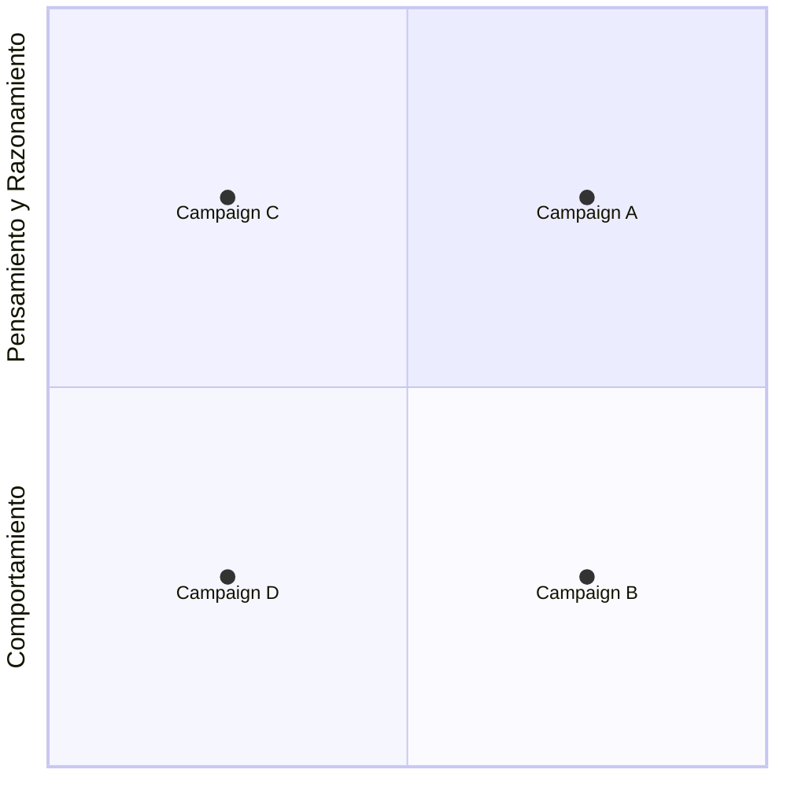

---
tags:
---
Date: 2025-03-26 : 16:12
***
## Módulo 2 (Valverde)
### Máquinas
- Por que tanto miedo a las máquinas? Miedo antiguo de que la creación se rebele contra su creador.
- Agente Autónomo: Algo que hace una única tarea de forma continua.

### Inteligencia Artificial
#### Historia
- Surge en 1956, y es creado por John McCarthy, el le da un orden y acuña el termino AI.
- Pero Alan Turing es el padre de la AI y de la computación.
- McCarthy desde los 50's ya imaginaba que el nombre iba a ser conflictivo.
- Inteligencia artificial no es una inteligencia, porque no se puede equiparar al raciocinio, por lo que no hay que creer que es un mounstro, simple mente **intenta imitar algunas de las tareas asociados con la inteligencia humana**.

#### Cada IA se entrena para realizar una tarea específica.
- Pero por ejemplo, ChatGPT hace varias taareas similares al mismo tiempo.
- Algunas IA's **no son capaces de realizar tareas sencillas** pero **pueden hacer trabajos complicados**.

#### Signos de Inteligencia
- Aprender de la experiencia.
- Encontrar sentido a mensajes ambiguos.
- Responder rapidamente a situaciones diversas.
- Entender e inferir de forma racional.
- Aplicar y adquirir conocimiento nuevo.

#### Organización de la IA
McCahrthy y su equipo organizó la IA en el siguiente cuadrante:
1. Sistemas que actúan como humanos (comportamiento)
2. Sistemas que piensan como humanos (pensamiento y razonamiento)
3. Sistemas que piensan racionalmente (pensamiento y razonamiento)
4. Sistemas que actúan racionalmente (comportamiento)

Chat es tipo 2, pero nos responde como 1.

#### Tipo 1: IA que Actúa como Humano
- El estudio de como hacer que las computadoras hagan tareas en las cuales hasta el momento el ser humano tiene un mejor desempoeño.
- **El modelo es el hombre:** El objetivo es construir un sistema que se pase por humano.

#### Tipo 2: IA que piensa como humano
- Es como el machine learning.
- El **modelo** es el funcionamiento de la mente, como piensa un humano, como deduce un humano.
- Ejemplo: Redes neuronales, se inspiran en el modelo cognitivo humano.

#### Tipo 3: IA que Piensa Racionalmente
- Las principales IA's que se implementaron fueron en los 70's. Un ejemplo era el sistema MISIN.
- Las leyes del pensamiento racional se basan en lógica.
- La lógica anterior no fue suficiente y por es se creo la **fuzzy logic** que es una lógica de estados, y es multiestados.

#### Tipo 4: IA que actua racionalmente
- Relacionada con conductas inteligentes en artefactos.
- Trae el paradigma del **agente**.

#### Agente
- Definición: Es algo que hace algo.
- Agente racional: Es aquel que actua con el fin de lograr el mejor resultado...
- Russel y Norvig: Todo aquello que percibe su ambiente y que reacciona al ambiente a través de acciones. PEAS

#### Agente Inteligente
Entidad **física o virtual** que posee ciertas características generales:
- Representar el entorno
- Percibir el entorno
- Actua en el entorno
- Puede comunicarse
- Posee objetivos
- Posee recursos propios.

Hacen lo correcto de a cuerdo a sus percepciones.

Es aquel que emprende la mejor acción posible en una situación dada.

#### Sueño de la IA
Que se pueda diseñar agente **inteligente/racional** que opere o actúe en diversos ambientes.

La IA generativa no es la respuesta, es la IA generalista.

#### Sistemas MultiAgentes
Sistemas complejos
- Se descomponen en agentes.
