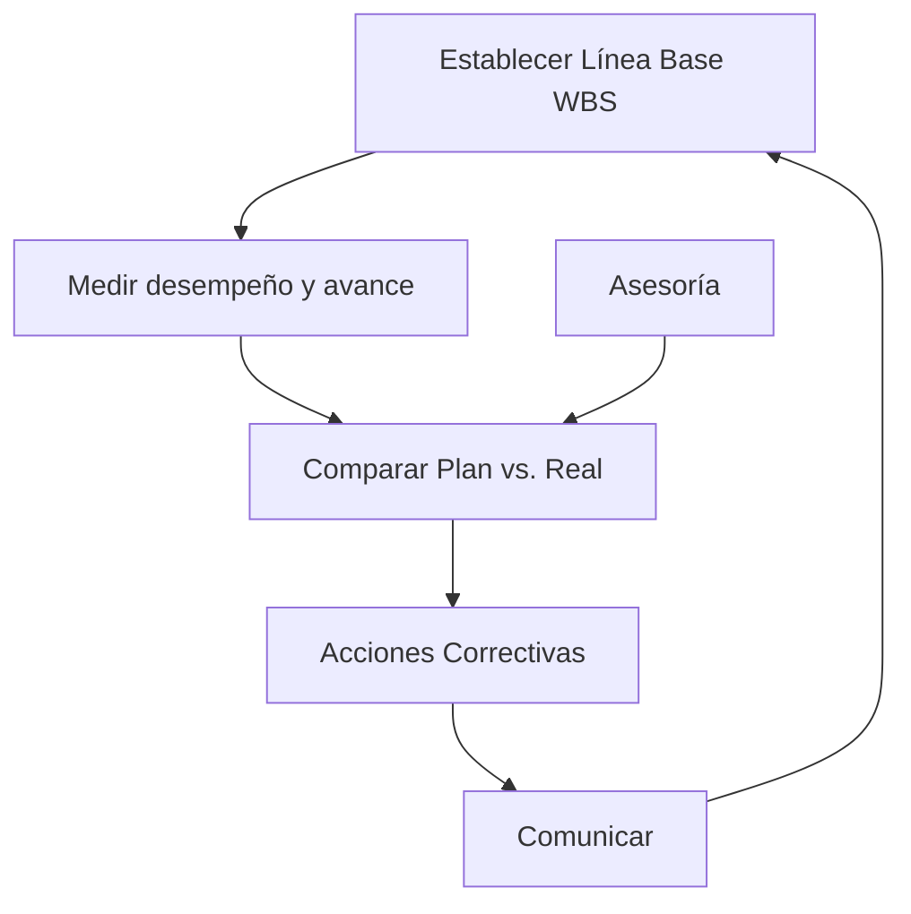

---
tags:
  - ceneval
---
Date: 2025-03-24 : 18:57
***
## Administración de Proyectos 
### Definición de Administración
#Q  #AOSR/19tds
- En el proceso de :: Lograr que las cosas se hagan. #AOSR/19tds/s/4vc0
- Utilizando cosas como :: Organización, delegación, planeación, etc. #AOSR/19tds/s/25t8

### Definición de Proyecto
#Q  #AOSR/21cgo
- Definición formal :: Esfuerzo **temporal** para crear **producto o servicio**. #AOSR/21cgo/s/30m6
- Un **proyecto** tiene bien definido un..., es un conjunto de tareas..., usa varios... no solo... tiene un... e involucra cierto... :: Objetivo, definidas, recursos, humanos, cliente/usuario, riesgo. #AOSR/21cgo/s/3p7b
- Un ejemplo de algo que **no** es proyecto son las... porque no tienen... :: Operaciones, fin. #AOSR/21cgo/s/297j

### Planeación y Diseño de Proyectos
#Q  #AOSR/7i9ot
- Es un error decir cosas como :: Quiero implementar AI. Quiero usar este rack. #AOSR/7i9ot/s/507g
1. Primero se **definen** los :: Requerimientos. #AOSR/7i9ot/s/4bp5
2. Los **requerimientos** definen :: Performance (Rendimiento). #AOSR/7i9ot/s/4f5u
3. El **rendimiento** define la :: Tecnología. #AOSR/7i9ot/s/1al5
4. La **tecnología** define :: Marca/Producto. #AOSR/7i9ot/s/1a2r

### Project Management
#Q  #AOSR/4cgkt
- La preocupación principal del PM es que :: El triángulo de **costo**, **tiempo** y **alcance** este balanceado. #AOSR/4cgkt/s/5ec9
- Si ese triángulo está balanceado :: El proyecto está en buen estado. #AOSR/4cgkt/s/2obs

### Procesos de la Administración de Proyectos
#Q  #AOSR/l29k5
- Las **5 partes** de administración de proyectos son :: Inicio, planeación, ejecución, monitoreo y control y cierre. #AOSR/l29k5/s/2bbr

#### Inicio
#Q 
- Hay que..., ..., y... el proyecto :: Identificar, definir, autorizar.
- Se presentan las... que ayudarán a... :: Ideas, solucionar problema.
- **Identificar** a :: Stakeholders clave.
- **Crear o escribir** el :: Project Charter.

#### Planeación
#Q 
- Se identifican y asignan :: Recursos.
- Se estima el :: Costo de proyecto.
- Se hacen cosas como el... y el... :: WBS, GANTT.
- También se tiene que desarrollar la :: Estrategia de administración de riesgos.

##### Estrategia de Administración de Riesgos
#Q 
- **Mitigación de riesgos** son los planes que buscan :: Reducir o eliminar el impacto de los riesgos.
- Los **pasos** para generar esta estrategia son :: 1) **Identificar** (Documentarlos). 2) **Assessment de Riesgos** (Medir. Matriz de Assessment de Riesgos) 3) **Priorizar** (Rank risks. Consider trade-offs) 4) **Monitorearlos** 5) **Reportarlos**.
- Las dos dimensiones de la **Matriz del Assessment de Riesgos** son :: Probabilidad e Impacto.
- Los **4 tipos** de estrategias de mitigación de riesgos son :: Aceptación, evasión, monitoreo y transferencia.
- **Aceptación** es cuando aceptas que a cambio de cierta... puede haber un... :: Ganancia, riesgo.
- **Evasión** es reducir la probabilidad de que pase riesgo mediante :: Toma de medidas.
- **Monitoreo** implica al riesgo... conteniendo... y evitando su... :: Aceptarlo, pérdidas, propagación.
- **Transferencia** implica pasar el riesgo a un :: Tercero.

#### Ejecución
#Q 
- Las actividades definidas en la planeación se :: Llevan a cabo
- Aquí los entregables son :: Productos del proyecto.

#### Monitoreo y Control
#Q 
- El avance **real** y el **planeado** se deben de :: Medir y comparar.
- Si algo no esta saliendo como debería de ser :: Tomar acciones para ir respecto al plan.
- Entregables de esta fase :: Informes de avance y peticiones de cambios.

#### Cierre
#Q 
- Formalizar que el proyecto **terminó** con :: El cliente.
- Hay que cerrar los :: Contratos.
- Hacer el informe de :: Cierre.
- Y documentar las :: Lecciones aprendidas.

### Planeación Programación y Control de Proyectos
#### Project Charter
#Q 
- Para el proyecto es la mejor herramienta de :: Marketing.
- Formalmente **autoriza**... y al PM le da la **autoridad** para aplicar... al proyecto :: El proyecto, recursos.
- Algunos de los aspectos que debe **contener** son :: Requerimientos, necesidades de negocio, cronograma resumido, limitaciones y caso de negocio.
- No debe tener **ningún** :: Peso legal.
- Debe estar escrito de forma :: Corta y simple.

#### Work Break-down Structure (WBS)
#Q 
- Nos sirve para **descomponer** el proyecto en :: Tareas.
- Va de lo... a lo... :: General, particular.
- Te detienes hasta que estés cómodo estimando :: Costo y tiempo.

#### Matriz de Responsabilidades
#Q 
- **Describe** la participación de varios... en completar... :: Roles, tareas.
- Los roles son **flexibles** una persona puede... o varias personas pueden... :: Ejercer varios, ejercer uno.
- Para la **matriz RACI** los **4 tipos de participación** son :: Responsible, accountable, consulted e informed.
- **Responsible** es quien a la tararea :: La completa.
- **Accountable** es quien tiene que... se encarga de... así como de checar que los... se encarga de... el trabajo :: Rendir cuentas, delegar trabajo, requisitos se cumplan, aprobar.
- **Consulted** es a quien le pides :: Opinión.
- **Informed** son a quienes le informas :: Estado de proyecto.
- Muchas veces el **accountable** es :: El responsible.
- Lo recomendable es que cada rol tenga un solo :: Tipo de participación.

#### Plan de Comunicación
#Q 
- Nos dice como le comunicaremos a los... información... del proyecto :: Stakeholders, importante.
- Las **preguntas** que debe resolver son :: Cómo? Qué? Quién? Cuándo? Dónde?
- Una **herramienta** útil para esto es :: Matriz de comunicación.

#### Diagrama de Gantt
#Q 
- Es una gráfica que nos **enseña**... y las  relaciones de... :: El cronograma del proyecto, dependencia.
- Sirve para :: Monitoreo y control.
- **No sirve** para... , más bien nos **ayuda a encontrar**... :: Planear, actividades paralelas.

#### CPM y PERT
#Q 
- CPM significa... y fue creado por... :: Critical Path Method, Dupont
- PERT significa... y fue creado por... ::  Program Evaluation & Review Technique, US Navy.
- La **diferencia principal** es que PERT es un método... y CPM es... :: Probabilístico, determinista
- Para **definir duración** de actividades PERT usa... y CPM usa... :: Estimación de tres puntos, estimación de un punto.
- Por ello PERT se usa más en proyectos... cuyas actividades... mientras que CPM es mejor para proyectos con cuyas actividades tenemos... :: Nuevos, no entendemos muy bien, mucha familiaridad.
- Ambos consideran **relaciones** de :: Precedencia e interdependencia.

##### Generalidades de Critical Path Method (CPM)
#Q 
- Ruta es una secuencia de actividades :: Conectadas.
- La **ruta crítica** es la más..., se forma por actividades cuyo **slack** es..., determina cuanto va a... :: Larga, 0, durar el proyecto.
- Las actividades que están en la ruta crítica se llaman :: Actividades críticas.
- **ES** significa... y es lo más.... Formula (si estamos en $Act_{n}$)... :: Earliest start, temprano que actividad puede empezar, $max \{ Act_{n-1,1}(EF), Act_{n-1,2}(EF), \dots, Act_{n-1,m}(EF) \}$
- **EF** significa... y es lo más.... Formula(si estamos en $Act_{n}$)... :: Earliest finish, temprano que actividad puede terminar, $Act_{n}(ES) + t$
- **LF** significa... y es lo más.... Formula(si estamos en $Act_{n}$)... :: Latest finish, tarde que actividad puede terminar sin afectar, $min \{ Act_{n+1,1}(LS), Act_{n+1,2}(LS), \dots, Act_{n+1,m}(LS) \}$
- **EF** significa... y es lo más.... Formula(si estamos en $Act_{n}$)... :: Earliest finish, temprano que actividad puede terminar, $Act_{n}(ES) + t$
- La **holgura** es el tiempo extra que se tiene para... sin... formula... :: Iniciar o terminar actividad, afectar proyecto, $H = LF - EF = LS - ES$
- Conocer las **actividades críticas** sirve para definir :: Plan de riesgo.
- Puede haber **mas de una ruta crítica** solo si :: Hay actividades en paralelo.

##### Generalidades de Program Evaluation & Review Technique (PERT)
- Los **tres** puntos de la estimación de PERT son :: Duración **óptima (O)**, duración **base o mas probable (L)** y duración **pesimista (P)**.
- Fórmula para el estimado :: $\frac{O + 4L + P}{6}$

#### Project Milestones
#Q 
- Sirven para marcar... durante el cronograma del proyecto :: Puntos específicos.
- Generalmente **no impactan** la :: Duración del proyecto.
- Se pueden combinar con métodos como... para saber si el proyecto va de acuerdo... :: CPR o PERT, a lo planeado.

### Seguimiento del Proyecto
#### Ejecución
#Q 
- Línea base es el :: WBS. 
- Evaluar rendimiento en los planes de :: Duración, Trabajo, Inicio y Costo.

#### Seguimiento
#Q 
- Se hace a través del :: Plan de Proyecto.
- Nos sirve de :: Guía.
- Permite identificar :: Variaciones.
- Sirve para hacer correcciones :: A tiempo.
- Su **objetivo** es determinar si el proyecto está o no :: Bajo control.

#### Evaluación y Control de Proyectos
#Q
- Sirve para lograr un proyecto **exitoso** en :: Calidad, Tiempo y Costo.
- Implica Darle seguimiento en sus diversas :: Fases.
- Corregir en cuanto se detecten :: Desviaciones.

#### Monitoreo y Control
#Q
- Se hace cuando el contrato requiere :: Reportes para pagos. 
- También si hay cambios :: Fuertes en el proyecto.
- También se hace si el tamaño y la complejidad del proyecto es :: Muy grande.
- Se deben tomar en cuenta cosas como :: Duración de actividad, Localización de recursos, lógica de Proyecto, Nuevas actividades. 
- Recabar datos de cosas como :: Trabajo, tiempo y recursos.
- Con todo eso generar :: Informes.

#### Control del Proyecto
#Q
- Proceso de **evaluar y comparar** los resultados... con los resultados... determina cosas como... :: Planeados, Obtenidos, Costos, Agenda y Objetivos.
- El **objetivo principal** es predecir el comportamiento... si las condiciones actuales... :: Futuro del proyecto, continuan.

#### Proyecto Bajo Control
#Q
- Si las metas se logran :: A tiempo.
- Con un nivel de :: Calidad.
- Con los recursos :: Estimados.

#### Definición de Control
#Q
- Se define como toda actividad de gestión que se asegura que el trabajo real va de acuerdo :: Al Plan.
- Compara lo realizado con las :: Metas y planes.
- Revela cuando y donde existen :: Desviaciones.
- Pone en marcha :: Aciones correctivas.

#### Proceso de Control


#### Actividades de Control
#Q
- Desarrollar estándares de :: Productividad.
- Establecer sistemas de monitorización de :: Informes.
- Medir los :: Resultados.
- Iniciar acciones :: Correctivas.

#### Control de Costos
#Q
- Incluye el monitoreo de los :: Costos.
- Para que solo se incluyan en el **análisis de costos** los :: Cambios apropiados.
- También sirve para informar a las personas correspondientes sobre los :: Cambios autorizados.

#### Earned Value Analysis

![[earned-value-analysis.png|600]]

#Q 
- Nos da una vista actual del :: Rendimiento del costo.
- Compara los costos de la... con los costos... :: Línea base, reales.
- Los **cinco conceptos** que maneja son :: Planed Value (PV), Actual Cost (AC), Earned Value (EV), Budget at Completion (BAC) y Estimate at Completion (EAC).
- **Planned Value (PV)** es lo que hemos :: Planeado para el proyecto.
- **Earned Value (EV)** es el :: Porcentaje entregado del proyecto.
- **Actual Cost** es lo que hemos realmente :: Gastado.
- **Budget at Completion** es el presupuesto :: Total y original del proyecto.
- **Estimate at Completion** es lo que se va haber gastado al :: Terminar el proyecto.

### Verificación del Alcance del Proyecto
#### Pasos para Controlar el Alcance del Proyecto
#Q 
- Documentación de los :: Requisitos.
- Rendimiento del alcance en relación con la :: Línea base del alcance.
- Determinar si se necesita actualizar la :: Línea Base del Alcance.
- Analizar el impacto de los :: Cambios en el Alcance.

### Cierre del Proyecto
#### Tipos de Terminación del Proyecto
#Q
- Los tres tipos son :: Por extinción, por adición y por inanición.
- Terminación **por extinción** se da cuando proyecto se detiene por conclusión :: Exitosa o Fallida.
- Terminación **por adición** se han cumplido... y se entrega el resultado... :: Todos los objetivos, esperado.
- Terminación **por inanición** se da cuando :: Los recursos se agotan.

## Estimación
### COMCOMO
#### Generalidades
#Q 
- COCOMO significa :: **Co**nstructructive **Co**st **Mo**del
- Fue desarrollado por... en el año... :: Barry Bohem, 1981.
- Sus cálculos se basan en la estimación de :: Líneas de código (LOC)
- COCOMO se basa en modelo de ciclo de vida de :: Cascada.

#### División
#Q
- Los **3 submodelos** en los que se divide COCOMO son :: Básico, intermedio y detallado.
- **Submodelo básico** es útil para obtener una buena... de cosas como... :: Aproximación, tiempo, esfuerzo, personal.
- **Submodelo intermedio** agrega... modificadores que son... con el fin de considerar el... :: 15, opcionales, entorno de trabajo.
- **Submodelo detallado** ajusta la cantidad de multiplicadores de :: Esfuerzo.
- Los **3 modos de desarrollo** de COCOMO son :: Orgánico, semi-acoplado y empotrado.

#### Fórmulas
#Q 
- En todas las fórmulas de COCOMO se consideran las constantes ($a, b, c$) las cuales cambian según el... y/o el... :: Submodelo, modo de desarrollo.
- Unidades de **esfuerzo $E$** son :: $[\frac{personas}{mes}]$
- Unidades de **tiempo $T$** son :: $[meses]$
- Unidades de **personal $P$** son :: $[personas]$
- Los **multiplicadores de esfuerzo $ME$** se usan en :: Submodelo intermedio
- **Fórmula de esfuerzo** para submodelo básico e intermedio respectivamente :: $E = ab(KLOC)$, $E = ab(KLOC)ME$
- **Fórmula de tiempo** para submodelo básico e intermedio respectivamente :: $T = cdE$, $T = cdE$
- **Fórmula de personal** para submodelo básico e intermedio respectivamente :: $P = \frac{E}{T}$, $T = \frac{E}{T}$

## Flashcards
```aosr-deck-config
{
	"rule": {
		"conditions": {
			"all": [{
				"fact": "card",
				"operator": "regexMatch",
				"value": "School/Ceneval/Guía/4. Gestión de Proyectos de Software/4.1 Gestión de Tiempos, Costos, Recursos Humanos y Riesgos.md",
				"path": "$.path"
			}]
		},
		"event": {
			"type": "match"
		}
	}
}
```