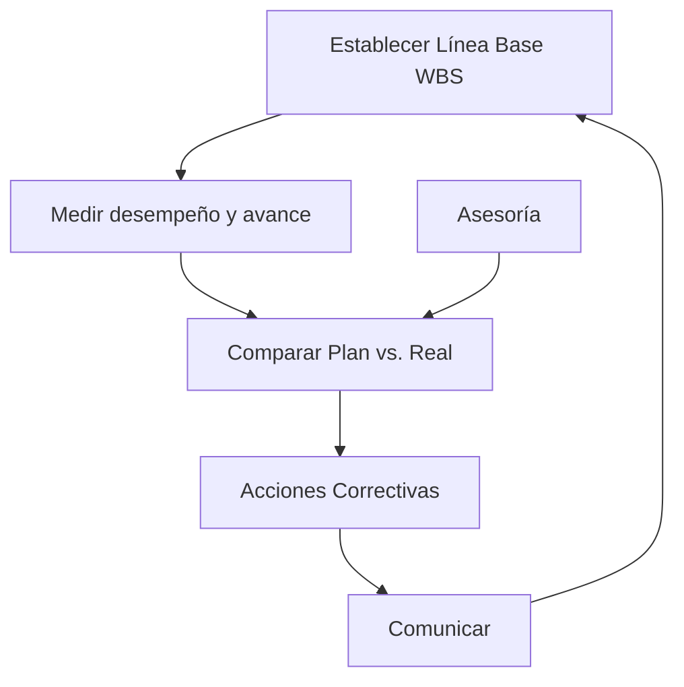

---
tags:
  - ceneval
---
Date: 2025-03-24 : 18:57
***
## Administración de Proyectos 
### Definición de Administración
#Q  #AOSR/19tds
- En el proceso de :: Lograr que las cosas se hagan. #AOSR/19tds/s/4vc0
- Utilizando cosas como :: Organización, delegación, planeación, etc. #AOSR/19tds/s/25t8

### Definición de Proyecto
#Q  #AOSR/21cgo
- Definición formal :: Esfuerzo **temporal** para crear **producto o servicio**. #AOSR/21cgo/s/30m6
- Un **proyecto** tiene bien definido un..., es un conjunto de tareas..., usa varios... no solo... tiene un... e involucra cierto... :: Objetivo, definidas, recursos, humanos, cliente/usuario, riesgo. #AOSR/21cgo/s/3p7b
- Un ejemplo de algo que **no** es proyecto son las... porque no tienen... :: Operaciones, fin. #AOSR/21cgo/s/297j

### Planeación y Diseño de Proyectos
#Q  #AOSR/7i9ot
- Es un error decir cosas como :: Quiero implementar AI. Quiero usar este rack. #AOSR/7i9ot/s/507g
1. Primero se **definen** los :: Requerimientos. #AOSR/7i9ot/s/4bp5
2. Los **requerimientos** definen :: Performance (Rendimiento). #AOSR/7i9ot/s/4f5u
3. El **rendimiento** define la :: Tecnología. #AOSR/7i9ot/s/1al5
4. La **tecnología** define :: Marca/Producto. #AOSR/7i9ot/s/1a2r

### Project Management
#Q  #AOSR/4cgkt
- La preocupación principal del PM es que :: El triángulo de **costo**, **tiempo** y **alcance** este balanceado. #AOSR/4cgkt/s/5ec9
- Si ese triángulo está balanceado :: El proyecto está en buen estado. #AOSR/4cgkt/s/2obs

### Procesos de la Administración de Proyectos
#Q  #AOSR/l29k5
- Las **5 partes** de administración de proyectos son :: Inicio, planeación, ejecución, monitoreo y control y cierre. #AOSR/l29k5/s/2bbr

#### Inicio
#Q  #AOSR/3bhbp
- Hay que..., ..., y... el proyecto :: Identificar, definir, autorizar. #AOSR/3bhbp/s/4br2
- Se presentan las... que ayudarán a... :: Ideas, solucionar problema. #AOSR/3bhbp/s/4p32
- **Identificar** a :: Stakeholders clave. #AOSR/3bhbp/s/7lb9
- **Crear o escribir** el :: Project Charter. #AOSR/3bhbp/s/4eej

#### Planeación
#Q  #AOSR/14tgh
- Se identifican y asignan :: Recursos. #AOSR/14tgh/s/3ji7
- Se estima el :: Costo de proyecto. #AOSR/14tgh/s/k8mk
- Se hacen cosas como el... y el... :: WBS, GANTT. #AOSR/14tgh/s/2b2e
- También se tiene que desarrollar la :: Estrategia de administración de riesgos. #AOSR/14tgh/s/dcgd

##### Estrategia de Administración de Riesgos
#Q  #AOSR/2fjkp
- **Mitigación de riesgos** son los planes que buscan :: Reducir o eliminar el impacto de los riesgos. #AOSR/2fjkp/s/3v1g
- Los **pasos** para generar esta estrategia son :: 1) **Identificar** (Documentarlos). 2) **Assessment de Riesgos** (Medir. Matriz de Assessment de Riesgos) 3) **Priorizar** (Rank risks. Consider trade-offs) 4) **Monitorearlos** 5) **Reportarlos**. #AOSR/2fjkp/s/3jjp
- Las dos dimensiones de la **Matriz del Assessment de Riesgos** son :: Probabilidad e Impacto. #AOSR/2fjkp/s/6lpc
- Los **4 tipos** de estrategias de mitigación de riesgos son :: Aceptación, evasión, monitoreo y transferencia. #AOSR/2fjkp/s/5bcs
- **Aceptación** es cuando aceptas que a cambio de cierta... puede haber un... :: Ganancia, riesgo. #AOSR/2fjkp/s/3kb7
- **Evasión** es reducir la probabilidad de que pase riesgo mediante :: Toma de medidas. #AOSR/2fjkp/s/1fke
- **Monitoreo** implica al riesgo... conteniendo... y evitando su... :: Aceptarlo, pérdidas, propagación. #AOSR/2fjkp/s/15fu
- **Transferencia** implica pasar el riesgo a un :: Tercero. #AOSR/2fjkp/s/2vc7

#### Ejecución
#Q  #AOSR/69q4t
- Las actividades definidas en la planeación se :: Llevan a cabo #AOSR/69q4t/s/3qqe
- Aquí los entregables son :: Productos del proyecto. #AOSR/69q4t/s/55k5

#### Monitoreo y Control
#Q  #AOSR/4d8g3
- El avance **real** y el **planeado** se deben de :: Medir y comparar. #AOSR/4d8g3/s/2ob8
- Si algo no esta saliendo como debería de ser :: Tomar acciones para ir respecto al plan. #AOSR/4d8g3/s/5ama
- Entregables de esta fase :: Informes de avance y peticiones de cambios. #AOSR/4d8g3/s/6i2g

#### Cierre
#Q  #AOSR/367qj
- Formalizar que el proyecto **terminó** con :: El cliente. #AOSR/367qj/s/6l4a
- Hay que cerrar los :: Contratos. #AOSR/367qj/s/43jf
- Hacer el informe de :: Cierre. #AOSR/367qj/s/2h2c
- Y documentar las :: Lecciones aprendidas. #AOSR/367qj/s/5go6

### Planeación Programación y Control de Proyectos
#### Project Charter
#Q  #AOSR/rtp37
- Para el proyecto es la mejor herramienta de :: Marketing. #AOSR/rtp37/s/2aoa
- Formalmente **autoriza**... y al PM le da la **autoridad** para aplicar... al proyecto :: El proyecto, recursos. #AOSR/rtp37/s/65mr
- Algunos de los aspectos que debe **contener** son :: Requerimientos, necesidades de negocio, cronograma resumido, limitaciones y caso de negocio. #AOSR/rtp37/s/47ds
- No debe tener **ningún** :: Peso legal. #AOSR/rtp37/s/ee28
- Debe estar escrito de forma :: Corta y simple. #AOSR/rtp37/s/2pqm

#### Work Break-down Structure (WBS)
#Q  #AOSR/bpm9b
- Nos sirve para **descomponer** el proyecto en :: Tareas. #AOSR/bpm9b/s/6b2m
- Va de lo... a lo... :: General, particular. #AOSR/bpm9b/s/4a2v
- Te detienes hasta que estés cómodo estimando :: Costo y tiempo. #AOSR/bpm9b/s/m9g7

#### Matriz de Responsabilidades
#Q  #AOSR/195kb
- **Describe** la participación de varios... en completar... :: Roles, tareas. #AOSR/195kb/s/7h98
- Los roles son **flexibles** una persona puede... o varias personas pueden... :: Ejercer varios, ejercer uno. #AOSR/195kb/s/7tlo
- Para la **matriz RACI** los **4 tipos de participación** son :: Responsible, accountable, consulted e informed. #AOSR/195kb/s/4ah9
- **Responsible** es quien a la tararea :: La completa. #AOSR/195kb/s/4bff
- **Accountable** es quien tiene que... se encarga de... así como de checar que los... se encarga de... el trabajo :: Rendir cuentas, delegar trabajo, requisitos se cumplan, aprobar. #AOSR/195kb/s/570i
- **Consulted** es a quien le pides :: Opinión. #AOSR/195kb/s/5c4j
- **Informed** son a quienes le informas :: Estado de proyecto. #AOSR/195kb/s/3gh9
- Muchas veces el **accountable** es :: El responsible. #AOSR/195kb/s/7pr4
- Lo recomendable es que cada rol tenga un solo :: Tipo de participación. #AOSR/195kb/s/2fj9

#### Plan de Comunicación
#Q  #AOSR/6b46i
- Nos dice como le comunicaremos a los... información... del proyecto :: Stakeholders, importante. #AOSR/6b46i/s/5k18
- Las **preguntas** que debe resolver son :: Cómo? Qué? Quién? Cuándo? Dónde? #AOSR/6b46i/s/63k0
- Una **herramienta** útil para esto es :: Matriz de comunicación. #AOSR/6b46i/s/4rui

#### Diagrama de Gantt
#Q  #AOSR/35qit
- Es una gráfica que nos **enseña**... y las  relaciones de... :: El cronograma del proyecto, dependencia. #AOSR/35qit/s/35n9
- Sirve para :: Monitoreo y control. #AOSR/35qit/s/5q9p
- **No sirve** para... , más bien nos **ayuda a encontrar**... :: Planear, actividades paralelas. #AOSR/35qit/s/ccpv

#### CPM y PERT
#Q  #AOSR/6gcfm
- CPM significa... y fue creado por... :: Critical Path Method, Dupont #AOSR/6gcfm/s/2hmd
- PERT significa... y fue creado por... ::  Program Evaluation & Review Technique, US Navy. #AOSR/6gcfm/s/7v7u
- La **diferencia principal** es que PERT es un método... y CPM es... :: Probabilístico, determinista #AOSR/6gcfm/s/4rl3
- Para **definir duración** de actividades PERT usa... y CPM usa... :: Estimación de tres puntos, estimación de un punto. #AOSR/6gcfm/s/125j
- Por ello PERT se usa más en proyectos... cuyas actividades... mientras que CPM es mejor para proyectos con cuyas actividades tenemos... :: Nuevos, no entendemos muy bien, mucha familiaridad. #AOSR/6gcfm/s/1ekc
- Ambos consideran **relaciones** de :: Precedencia e interdependencia. #AOSR/6gcfm/s/2p4o

##### Generalidades de Critical Path Method (CPM)
#Q  #AOSR/28r3d
- Ruta es una secuencia de actividades :: Conectadas. #AOSR/28r3d/s/j6q5
- La **ruta crítica** es la más..., se forma por actividades cuyo **slack** es..., determina cuanto va a... :: Larga, 0, durar el proyecto. #AOSR/28r3d/s/5m1n
- Las actividades que están en la ruta crítica se llaman :: Actividades críticas. #AOSR/28r3d/s/z335
- **ES** significa... y es lo más.... Formula (si estamos en $Act_{n}$)... :: Earliest start, temprano que actividad puede empezar, $max \{ Act_{n-1,1}(EF), Act_{n-1,2}(EF), \dots, Act_{n-1,m}(EF) \}$ #AOSR/28r3d/s/5tud
- **EF** significa... y es lo más.... Formula(si estamos en $Act_{n}$)... :: Earliest finish, temprano que actividad puede terminar, $Act_{n}(ES) + t$ #AOSR/28r3d/s/z183
- **LF** significa... y es lo más.... Formula(si estamos en $Act_{n}$)... :: Latest finish, tarde que actividad puede terminar sin afectar, $min \{ Act_{n+1,1}(LS), Act_{n+1,2}(LS), \dots, Act_{n+1,m}(LS) \}$ #AOSR/28r3d/s/3avj
- **EF** significa... y es lo más.... Formula(si estamos en $Act_{n}$)... :: Earliest finish, temprano que actividad puede terminar, $Act_{n}(ES) + t$
- La **holgura** es el tiempo extra que se tiene para... sin... formula... :: Iniciar o terminar actividad, afectar proyecto, $H = LF - EF = LS - ES$ #AOSR/28r3d/s/10tj
- Conocer las **actividades críticas** sirve para definir :: Plan de riesgo. #AOSR/28r3d/s/41k4
- Puede haber **mas de una ruta crítica** solo si :: Hay actividades en paralelo. #AOSR/28r3d/s/1ep8

##### Generalidades de Program Evaluation & Review Technique (PERT)
- Los **tres** puntos de la estimación de PERT son :: Duración **óptima (O)**, duración **base o mas probable (L)** y duración **pesimista (P)**.
- Fórmula para el estimado :: $\frac{O + 4L + P}{6}$

#### Project Milestones
#Q  #AOSR/122r5
- Sirven para marcar... durante el cronograma del proyecto :: Puntos específicos. #AOSR/122r5/s/6ri3
- Generalmente **no impactan** la :: Duración del proyecto. #AOSR/122r5/s/4btn
- Se pueden combinar con métodos como... para saber si el proyecto va de acuerdo... :: CPR o PERT, a lo planeado. #AOSR/122r5/s/lrap

### Seguimiento del Proyecto
#### Ejecución
#Q  #AOSR/6oqbt
- Línea base es el :: WBS.  #AOSR/6oqbt/s/36vf
- Evaluar rendimiento en los planes de :: Duración, Trabajo, Inicio y Costo. #AOSR/6oqbt/s/4li5

#### Seguimiento
#Q  #AOSR/7u9dn
- Se hace a través del :: Plan de Proyecto. #AOSR/7u9dn/s/49tc
- Nos sirve de :: Guía. #AOSR/7u9dn/s/niik
- Permite identificar :: Variaciones. #AOSR/7u9dn/s/62aq
- Sirve para hacer correcciones :: A tiempo. #AOSR/7u9dn/s/431n
- Su **objetivo** es determinar si el proyecto está o no :: Bajo control. #AOSR/7u9dn/s/3i9l

#### Evaluación y Control de Proyectos
#Q #AOSR/51bkm
- Sirve para lograr un proyecto **exitoso** en :: Calidad, Tiempo y Costo. #AOSR/51bkm/s/1ks6
- Implica Darle seguimiento en sus diversas :: Fases. #AOSR/51bkm/s/5i99
- Corregir en cuanto se detecten :: Desviaciones. #AOSR/51bkm/s/5nhp

#### Monitoreo y Control
#Q #AOSR/2t4me
- Se hace cuando el contrato requiere :: Reportes para pagos.  #AOSR/2t4me/s/5ta1
- También si hay cambios :: Fuertes en el proyecto. #AOSR/2t4me/s/2aos
- También se hace si el tamaño y la complejidad del proyecto es :: Muy grande. #AOSR/2t4me/s/62o2
- Se deben tomar en cuenta cosas como :: Duración de actividad, Localización de recursos, lógica de Proyecto, Nuevas actividades.  #AOSR/2t4me/s/ek02
- Recabar datos de cosas como :: Trabajo, tiempo y recursos. #AOSR/2t4me/s/4acm
- Con todo eso generar :: Informes. #AOSR/2t4me/s/3rlj

#### Control del Proyecto
#Q #AOSR/14fv8
- Proceso de **evaluar y comparar** los resultados... con los resultados... determina cosas como... :: Planeados, Obtenidos, Costos, Agenda y Objetivos. #AOSR/14fv8/s/7tea
- El **objetivo principal** es predecir el comportamiento... si las condiciones actuales... :: Futuro del proyecto, continuan. #AOSR/14fv8/s/7iao

#### Proyecto Bajo Control
#Q #AOSR/4mvdt
- Si las metas se logran :: A tiempo. #AOSR/4mvdt/s/6kg5
- Con un nivel de :: Calidad. #AOSR/4mvdt/s/3dco
- Con los recursos :: Estimados. #AOSR/4mvdt/s/694j

#### Definición de Control
#Q #AOSR/c5t2r
- Se define como toda actividad de gestión que se asegura que el trabajo real va de acuerdo :: Al Plan. #AOSR/c5t2r/s/2eg5
- Compara lo realizado con las :: Metas y planes. #AOSR/c5t2r/s/jhu1
- Revela cuando y donde existen :: Desviaciones. #AOSR/c5t2r/s/5q1k
- Pone en marcha :: Aciones correctivas. #AOSR/c5t2r/s/15qv

#### Proceso de Control


#### Actividades de Control
#Q #AOSR/4ln1l
- Desarrollar estándares de :: Productividad. #AOSR/4ln1l/s/56j2
- Establecer sistemas de monitorización de :: Informes. #AOSR/4ln1l/s/6m7e
- Medir los :: Resultados. #AOSR/4ln1l/s/5fkk
- Iniciar acciones :: Correctivas. #AOSR/4ln1l/s/3o07

#### Control de Costos
#Q #AOSR/spro4
- Incluye el monitoreo de los :: Costos. #AOSR/spro4/s/z281
- Para que solo se incluyan en el **análisis de costos** los :: Cambios apropiados. #AOSR/spro4/s/ruir
- También sirve para informar a las personas correspondientes sobre los :: Cambios autorizados. #AOSR/spro4/s/4r2h

#### Earned Value Analysis

![[earned-value-analysis.png|600]]

#Q  #AOSR/6ferm
- Nos da una vista actual del :: Rendimiento del costo. #AOSR/6ferm/s/58id
- Compara los costos de la... con los costos... :: Línea base, reales. #AOSR/6ferm/s/6g0g
- Los **cinco conceptos** que maneja son :: Planed Value (PV), Actual Cost (AC), Earned Value (EV), Budget at Completion (BAC) y Estimate at Completion (EAC). #AOSR/6ferm/s/osn9
- **Planned Value (PV)** es lo que hemos :: Planeado para el proyecto. #AOSR/6ferm/s/7o85
- **Earned Value (EV)** es el :: Porcentaje entregado del proyecto. #AOSR/6ferm/s/6u5c
- **Actual Cost** es lo que hemos realmente :: Gastado. #AOSR/6ferm/s/1b2d
- **Budget at Completion** es el presupuesto :: Total y original del proyecto. #AOSR/6ferm/s/5b2t
- **Estimate at Completion** es lo que se va haber gastado al :: Terminar el proyecto. #AOSR/6ferm/s/6upn

### Verificación del Alcance del Proyecto
#### Pasos para Controlar el Alcance del Proyecto
#Q  #AOSR/4pob2
- Documentación de los :: Requisitos. #AOSR/4pob2/s/5bpo
- Rendimiento del alcance en relación con la :: Línea base del alcance. #AOSR/4pob2/s/5nl7
- Determinar si se necesita actualizar la :: Línea Base del Alcance. #AOSR/4pob2/s/5jm9
- Analizar el impacto de los :: Cambios en el Alcance. #AOSR/4pob2/s/5n7i

### Cierre del Proyecto
#### Tipos de Terminación del Proyecto
#Q #AOSR/4la1m
- Los tres tipos son :: Por extinción, por adición y por inanición. #AOSR/4la1m/s/d84m
- Terminación **por extinción** se da cuando proyecto se detiene por conclusión :: Exitosa o Fallida. #AOSR/4la1m/s/4fq5
- Terminación **por adición** se han cumplido... y se entrega el resultado... :: Todos los objetivos, esperado.
- Terminación **por inanición** se da cuando :: Los recursos se agotan.

## Estimación
### COMCOMO
#### Generalidades
#Q 
- COCOMO significa :: **Co**nstructructive **Co**st **Mo**del
- Fue desarrollado por... en el año... :: Barry Bohem, 1981.
- Sus cálculos se basan en la estimación de :: Líneas de código (LOC)
- COCOMO se basa en modelo de ciclo de vida de :: Cascada.

#### División
#Q
- Los **3 submodelos** en los que se divide COCOMO son :: Básico, intermedio y detallado.
- **Submodelo básico** es útil para obtener una buena... de cosas como... :: Aproximación, tiempo, esfuerzo, personal.
- **Submodelo intermedio** agrega... modificadores que son... con el fin de considerar el... :: 15, opcionales, entorno de trabajo.
- **Submodelo detallado** ajusta la cantidad de multiplicadores de :: Esfuerzo.
- Los **3 modos de desarrollo** de COCOMO son :: Orgánico, semi-acoplado y empotrado.

#### Fórmulas
#Q 
- En todas las fórmulas de COCOMO se consideran las constantes ($a, b, c$) las cuales cambian según el... y/o el... :: Submodelo, modo de desarrollo.
- Unidades de **esfuerzo $E$** son :: $[\frac{personas}{mes}]$
- Unidades de **tiempo $T$** son :: $[meses]$
- Unidades de **personal $P$** son :: $[personas]$
- Los **multiplicadores de esfuerzo $ME$** se usan en :: Submodelo intermedio
- **Fórmula de esfuerzo** para submodelo básico e intermedio respectivamente :: $E = ab(KLOC)$, $E = ab(KLOC)ME$
- **Fórmula de tiempo** para submodelo básico e intermedio respectivamente :: $T = cdE$, $T = cdE$
- **Fórmula de personal** para submodelo básico e intermedio respectivamente :: $P = \frac{E}{T}$, $T = \frac{E}{T}$

## Flashcards
```aosr-deck-config
{
	"rule": {
		"conditions": {
			"all": [{
				"fact": "card",
				"operator": "regexMatch",
				"value": "School/Ceneval/Guía/4. Gestión de Proyectos de Software/4.1 Gestión de Tiempos, Costos, Recursos Humanos y Riesgos.md",
				"path": "$.path"
			}]
		},
		"event": {
			"type": "match"
		}
	}
}
```