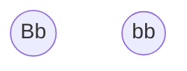

---
tags:
  - biology
  - evolutionary-biology
---
Date: 2024-09-05 : 13:27
***
## 1.1 Genetic Information
### How the DNA Works?
The **phenotype** is a result of **genetic information**. Most of the times, this info is stored in the **DNA**, but in viruses is stored in the **RNA**. 

The info in the DNA, gets transcribed into RNA (mRNA or rRNA) for creating proteins or expressing genes.

DNA has many segments, for instance, many genes. Genes have different regions:
- Promotors
- Enhancers
- Introns
- Extrons

DNA has a structural part **desoxyriboses**, which are linked through a **phosphodiester**. All this has bases:
- **DNA:** Purines (A, G) and pyrimidines (T, C).
- **RNA:** Purines (A, G) and pyrimidines (U, C).

The bases are linked through **hydrogen bonds**. And are complementary to each other.

When encoding a protein, each codon generates certain **amino acid** that is later or polymerized into a **protein**. In total we have $4^{3} = 64$ possible codon combinations:
- **Sense Codes:** Are 61, encode 20 amino acids.
- **Non-Sense Codes:** Are 3, stop codons.

### Types of Mutations
**Point Mutation:** Is any time some factor alters the original base the DNA had, leading to another one.

**Synonymous Mutation:** Mutations that do not change the original amino acid.

**Non-Synonymous Mutations:** Incorporation of a different amino acid than the one should be.

**Transition:** Changes between purines or pyrimidines. (With themselves) (More common).

**Transversions:** Changes between a purine with a pyrimidine of viceversa. (Less common).

**Indels:** They occur during duplication. Can be either **deletion** or **insertion** of one or more nucleotides. They are rare.

**Mutations in Splicing:** The process of joining exons and removing introns is called splicing. When done incorrectly, can lead to mutations.

### Genetic Variation
**Recombination:** When parts of different DNA stands are fused in one. This usually occurs during **meiosis**.

**Gene Duplication:** It has many forms. In general what happens is that the genome gets larger involving *one* to *many* genes.

## 1.2 Population Dynamics
### Alleles, Locus & Fixation
Usually we have polymorphisms that lead to variants of a gene in a population. The location of this polymorphism is called **locus**. The different variants of a locus are called **alleles**.

Diploid organisms carry two alleles, for instance:
- If both alleles are the *same*, the organism is **homozygous**.
- If the alleles are *different*, the organism is **heterozygous**.

Assume we have the following population:

Where B and b are both alleles. We can say that the **allele frequency** of allele B is $f(B) = \frac{1}{4}$, while the one for allele b is $f(b) = \frac{3}{4}$.

Some alleles are lost, while others become fixed. The rate in which this happens is the **fixation rate**.

The **selective pressure** is the pressure an allele gets due to the environment given its fitness. If the allele is fit, it will have *positive selective pressure*.

### Population Size
The **effective population size ($N_{e}$)** is the sized of an imaginary population that is *randomly* mating and has the same *gene frequency changes* as the studied population.

The **overall population size ($N$)** is the total number of members in a population. When there is *no offspring*, *inbreeding* and *subdivision* $N_{e} < N$. 

The **rates of evolution** are very influenced by *effective population size*. For example, a catastrophe or migration can alter it. 

Evolution is a combination of both stochastic and deterministic events. For instance **natural selection** changes *allele frequency* due to selective pressure, while **genetic drift** changes *allele frequencies* in a totally random manner.

## 1.3 Evolution and Speciation
When a species divides and becomes two there are forces that *decrease* variation **inside a population** and forces that *increase* variation **within populations**.

While **migration** prevents speciation because allows an exchange of mutations between populations, **isolation** favors speciation.

There are many types of speciation:
- **Allopatric Speciation:** Reproductive isolation, due to effects like geography.
- **Sympatric Speciation:** Adapt to different ecological factors, without reproductive isolation.
- **Parapatric Speciation:** Something between allotropic and sympatric speciation.

## 1.4 Data Used for Molecular Phylogenetics
To estimate relationship between species the most common thing is comparing **morphological characters**, but now a days, we can use nucleotide sequences.

Phylogenetic methods consider similarities between genes, assuming they **come from the same ancestor**, that is *homology*. In fact, the more similarity between two sequences, the more the probable the sequences are **homologous**.

In related species, similar genes only differ by a few point mutations. Additionally, some genes are more **conserved** than others, for example, the ones for DNA related processes.

To see differences between related species, use **nucleotide sequences**. To see differences between families and generations, use **amino acid sequences**.

In order to find these relations, we need to **align homologous regions**. The more distant the organisms are, the more difficult the process.

Evolution under similar *selective pressures* can give us **parallel** or **convergent evolution**. This can led to a big similarity, that can be mistaken with a **homology**.

## 1.5 What is a Phylogenetic Tree?
Is any diagram that shows the relation of *closely related* organisms or genes. They have different parts:
- **Operational Taxonomic Units (OTU's):** The leaves.
- **Hypothetical Taxonomic Units (HTU's):** The nodes.

If a group of taxa shares the same branch it is **monophyletic**, otherwise it is **paraphyletic**. Additionally, the root is the **most distant ancestor**.

## 1.6 Methods for Inferring Phylogenetic Trees
There are many methods, non of which is 100% trustable, they can be grouped as:
- **Character-State Methods:** Use discrete data (sequences, morphological, etc.). Each aligned sequence is a *character* and the nucleotides are the *states*.
- **Distance-Matrix Methods:** Calculate a difference matrix to infer relations. They are faster, but less effective.
- **Maximum Likelihood Methods:** Use probability, but can only be used for limited number of OTU's.
- **Clustering Methods:** Instead of evaluating many trees, they *cluster* data into a single one.

## 1.7 Is Evolution Always Tree-Like
Generally speaking trees have only **two branches**, but this is not always the case. For example the HIV virus mutates a lot, thus two leaves isn't enough.

The presence of more than two leaves is called **polytomy**, for instance:
- **Hard Polytomy:** Many branches (difficult to prove).
- **Soft Polytomy:** Unresolved tree topology

In the case of **recombination** there can be more than *one three*. Thus, it would be better to use a network.
