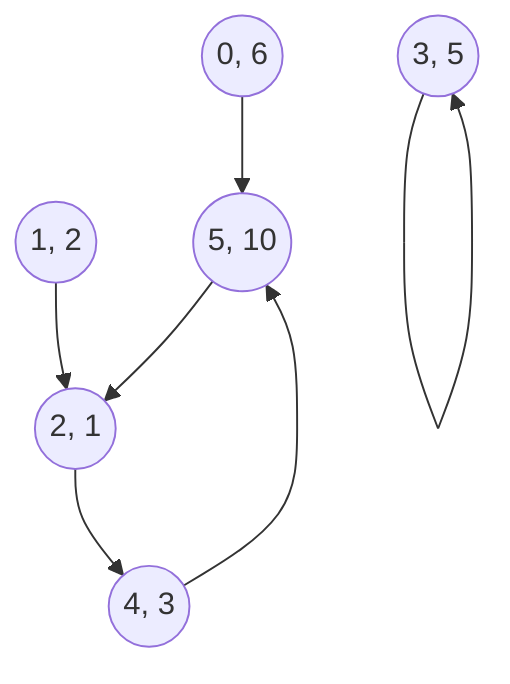

---
tags:
  - quantum-computing
---
Date: 2024-08-14 : 20:41
***
## 3.1 Classical Deterministic Systems
Assume that we have a weighted graph, where every vertex are marbles and in every click those marbles move is there is a connection with another vertex. 

This system can be represented using two artifacts. First, a **vector state** $X_{i}$ that gives us the state of every vertex and secondly, a **boolean adjacency matrix** $B$ that tells us where are the connections.
$$
X_{0} =
\begin{bmatrix}
6 \\
2 \\
1 \\
5 \\
3 \\
10
\end{bmatrix}, ~
B = 
\begin{bmatrix}
0 & 0 & 0 & 0 & 0 & 0 \\
0 & 0 & 0 & 0 & 0 & 0 \\
0 & 1 & 0 & 0 & 0 & 1 \\
0 & 0 & 0 & 1 & 0 & 0 \\
0 & 0 & 1 & 0 & 0 & 0 \\
1 & 0 & 0 & 0 & 1 & 0 \\
\end{bmatrix}
$$
The state equation is the following:
$$
X_{i + 1} = B \cdot X_{i}
$$
We can calculate multiple steps in one go considering:
$$
X_{i + 2} = BX_{i + 1} = B^{2}X_{i}
$$
$$
X_{i + k} = B^{k}X_{i}
$$

## 3.2 Probabilistic Systems
