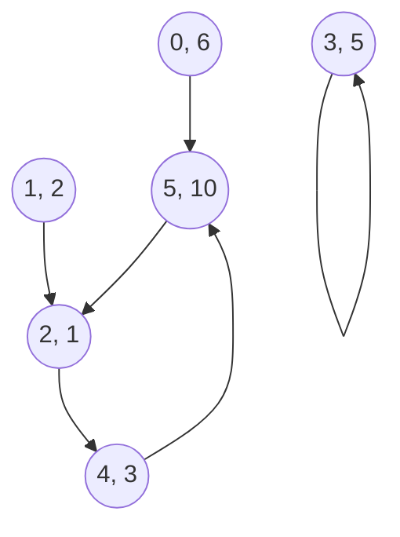
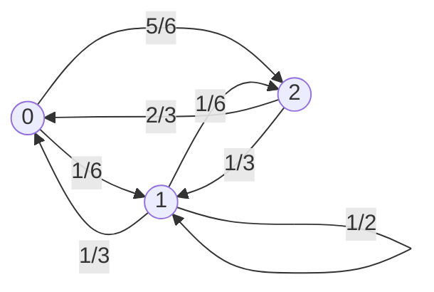
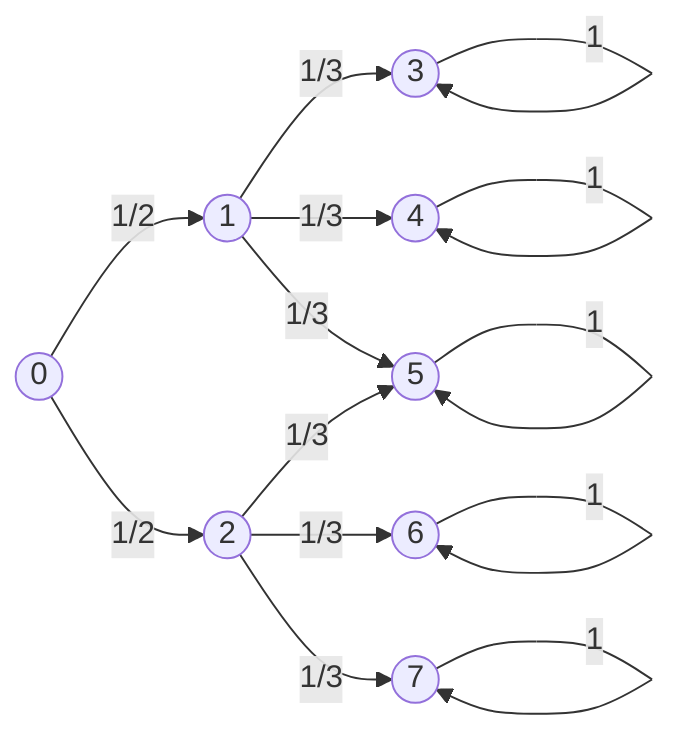

---
tags:
  - quantum-computing
  - probabilistic-system
---
Date: 2024-08-14 : 20:41
***
## 3.1 Classical Deterministic Systems
Assume that we have a weighted graph, where every vertex are marbles and in every click those marbles move is there is a connection with another vertex. 

This system can be represented using two artifacts. First, a **vector state** $X_{i}$ that gives us the state of every vertex and secondly, a **boolean adjacency matrix** $B$ that tells us where are the connections.
$$
X_{0} =
\begin{bmatrix}
6 \\
2 \\
1 \\
5 \\
3 \\
10
\end{bmatrix}, ~
B = 
\begin{bmatrix}
0 & 0 & 0 & 0 & 0 & 0 \\
0 & 0 & 0 & 0 & 0 & 0 \\
0 & 1 & 0 & 0 & 0 & 1 \\
0 & 0 & 0 & 1 & 0 & 0 \\
0 & 0 & 1 & 0 & 0 & 0 \\
1 & 0 & 0 & 0 & 1 & 0 \\
\end{bmatrix}
$$
The state equation is the following:
$$
X_{i + 1} = B \cdot X_{i}
$$
We can calculate multiple steps in one go considering:
$$
X_{i + 2} = BX_{i + 1} = B^{2}X_{i}
$$
$$
X_{i + k} = B^{k}X_{i}
$$

## 3.2 Probabilistic Systems
### Generalities
Of course we not always know where the marbles are going to be, and thats why we should work with probabilities, both in the **state vector** and in the **adjacency matrix**. In this case we'll assume there's just one marble in the system and the weight of the edges is the probability of shifting from one vertex to another. For instance, consider the following graph:

Because we are working with probabilities, the **sum of the components of the state vector** should be one, while the **sum of the outgoing edges of every vertex** should be one too. Both the state vector and the adjacency matrix are presented below:
$$
X_{0} = 
\begin{bmatrix}
\frac{1}{6} \\
\frac{1}{6} \\
\frac{2}{3} \\
\end{bmatrix}, ~
B = 
\begin{bmatrix}
0 & \frac{1}{6} & \frac{5}{6} \\
\frac{1}{3} & \frac{1}{2} & \frac{1}{6} \\
\frac{2}{3} & \frac{1}{3} & 0 \\
\end{bmatrix}
$$

As we can see, we can calculate the probability of the marble ending up in each position by multiplying:
$$
X_{1} = BX_{0}
\begin{bmatrix}
0 & \frac{1}{6} & \frac{5}{6} \\
\frac{1}{3} & \frac{1}{2} & \frac{1}{6} \\
\frac{2}{3} & \frac{1}{3} & 0 \\
\end{bmatrix}
\begin{bmatrix}
\frac{1}{6} \\
\frac{1}{6} \\
\frac{2}{3} \\
\end{bmatrix}
=
\begin{bmatrix}
\frac{21}{36} \\
\frac{9}{36} \\
\frac{6}{36} \\
\end{bmatrix}
$$

It's important to note that the adjacency matrix is a [**doubly stochastic matrix**](https://en.wikipedia.org/wiki/Doubly_stochastic_matrix), which is a matrix where $i = j$ (squared) of the form:
$$
\sum_{i}x_{ij} = \sum_{j}x_{ij} = 1
$$

If we **transpose** the adjacency matrix is equivalent to going back in time or, reversing the arrows:

Now, as with the deterministic system, calculating the $k^{th}$ click is as follows:
$$
X_{i + k} = B^{k}X_{i}
$$

### Example: The Probabilistic Double-Slit Experiment
![[fig3.1.png|400]]

Considering the previous scenario. Entering each slit has a probability of $\frac{1}{2}$. Now, because each slit is equidistant to every target the probability of hitting any of them, after entering a slit is $\frac{1}{3}$. Thus, the **weighted graph** looks as follows:

The adjacency matrix looks as $B$, but because our interest is what happens after two steps, we calculate $B^{2}$:
$$
B = 
\begin{bmatrix}
0 & 0 & 0 & 0 & 0 & 0 & 0 & 0 \\
\frac{1}{2} & 0 & 0 & 0 & 0 & 0 & 0 & 0 \\
\frac{1}{2} & 0 & 0 & 0 & 0 & 0 & 0 & 0 \\
0 & \frac{1}{3} & 0 & 1 & 0 & 0 & 0 & 0 \\
0 & \frac{1}{3} & 0 & 0 & 1 & 0 & 0 & 0 \\
0 & \frac{1}{3} & \frac{1}{3} & 0 & 0 & 1 & 0 & 0 \\
0 & 0 & \frac{1}{3} & 0 & 0 & 0 & 1 & 0 \\
0 & 0 & \frac{1}{3} & 0 & 0 & 0 & 0 & 1 \\
\end{bmatrix}, ~
B^{2} =
\begin{bmatrix}
0 & 0 & 0 & 0 & 0 & 0 & 0 & 0 \\
0 & 0 & 0 & 0 & 0 & 0 & 0 & 0 \\
0 & 0 & 0 & 0 & 0 & 0 & 0 & 0 \\
0 & 0 & 0 & 0 & 0 & 0 & 0 & 0 \\
0 & 0 & 0 & 0 & 0 & 0 & 0 & 0 \\
0 & 0 & 0 & 0 & 0 & 0 & 0 & 0 \\
0 & 0 & 0 & 0 & 0 & 0 & 0 & 0 \\
0 & 0 & 0 & 0 & 0 & 0 & 0 & 0 \\
\end{bmatrix}
$$

