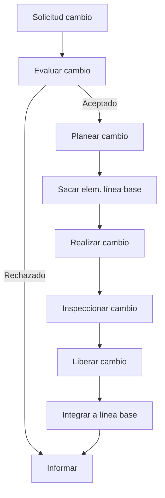

---
tags:
  - configuration-management
  - change-control
---
Date: 2024-06-10 : 20:26
***

## Propósito
#Q  #AOSR/30rkg
- Su propósito es mantener la :: Integridad del producto. #AOSR/30rkg/s/3jvn
- En todos sus :: Estados. #AOSR/30rkg/s/63tv
- Desde los..., hasta un producto... :: Requerimientos, funcional validado. #AOSR/30rkg/s/1dgp
- Ya que los cambios se necesitan durante :: Todo el desarrollo. #AOSR/30rkg/s/4m5k
	- Y hasta después de su :: Lanzamiento. #AOSR/30rkg/s/3eve

## Causas que Originan Peticiones de Cambio
#Q  #AOSR/3ca6v
1. Nuevos :: Requerimientos. #AOSR/3ca6v/s/1qbh
2. Condiciones o Eventos :: Inesperados. #AOSR/3ca6v/s/4s1h
3. Evolución en el... o en la... :: Diseño, Tecnología. #AOSR/3ca6v/s/4o0a
4. Errores en cosas como :: Diseño, Implementación, Calendarización y Estimación. #AOSR/3ca6v/s/1h2a
5. Materialización de :: Riesgos. #AOSR/3ca6v/s/1r4k

## Actividades y Tareas en el Control de Cambios
#Q  #AOSR/7c6m2
1. Establecer una... de control de cambios :: Infraestructura. #AOSR/7c6m2/s/a7nb
	- Designar los... sujetos a control de cambios :: Elementos. #AOSR/7c6m2/s/4run
2. Establecer... y... de evaluación de cambios :: Criterios, Autoridades. #AOSR/7c6m2/s/z367
3. Establecer el... de solicitud de cambios :: Formulario. #AOSR/7c6m2/s/6kod
4. Controlar los cambios en todos los :: Elementos de Configuración. #AOSR/7c6m2/s/itlb

##  Petición de Cambios
#Q  #AOSR/2ckg9
- Es un paso formal que inicia :: El proceso de cambios. #AOSR/2ckg9/s/3fns

#Q #AOSR/nj8ct
- Se deben especificar cosas como:
? #AOSR/nj8ct/m/71g8
- Fecha de la solicitud.
- Proyecto y versión.
- Descripción del Cambio.
- Problema que se quiere resolver.
- Causas o beneficios.
- Impacto en tiempo y costo.
- Justificación.

## Proceso de Solicitud de Cambio
#Q  #AOSR/4qgo6
- Una línea base es un punto de referencia :: Fijo. #AOSR/4qgo6/s/3n6q
- Por ejemplo nuestra baseline al inicio del bloque fue :: El SRS. #AOSR/4qgo6/s/301k


## Resultados de Solicitud de Cambios
#Q  #AOSR/7hfm7
- Las solicitudes de cambio aprobadas se formalizan en el :: Documento de Petición de Cambios. #AOSR/7hfm7/s/3r9i
- Se documentan cambios en :: Implicaciones, Alcance y Calidad, Tiempo y Costo. #AOSR/7hfm7/s/4ok9
- Se actualiza el :: Plan de Administración del Proyecto. #AOSR/7hfm7/s/1fj7
	- Se definen :: Nuevas tareas. #AOSR/7hfm7/s/3aoq
	- Se actualiza la :: Línea Base. #AOSR/7hfm7/s/57q4
	- Se actualizan :: Tiempos, recursos y riesgos. #AOSR/7hfm7/s/226q
- Se actualiza la :: Documentación Técnica. #AOSR/7hfm7/s/47c8
	- Se basa en los... realizados en el sistema :: Cambios. #AOSR/7hfm7/s/1aqi

## Flashcards
```aosr-deck-config
{
	"rule": {
		"conditions": {
			"all": [{
				"fact": "card",
				"operator": "regexMatch",
				"value": "School/TC3005B/TC3005B.1/3. Control de Cambios de la Configuración",
				"path": "$.path"
			}]
		},
		"event": {
			"type": "match"
		}
	}
}
```
