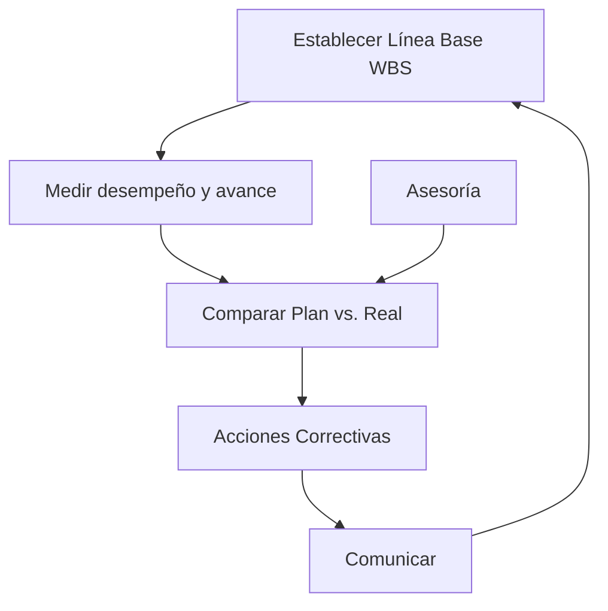

---
tags:
  - project-management
  - project-closure
---
Date: 2024-06-11 : 17:21
***

## Seguimiento del Proyecto
### Ejecución
#Q #AOSR/605rt
- Línea base es el :: WBS. #AOSR/605rt/s/7fcj
- Evaluar rendimiento en los planes de :: Duración, Trabajo, Inicio y Costo. #AOSR/605rt/s/4li5

### Seguimiento
#Q  #AOSR/30a3j
- Se hace a través del :: Plan de Proyecto. #AOSR/30a3j/s/49tc
- Nos sirve de :: Guía. #AOSR/30a3j/s/niik
- Permite identificar :: Variaciones. #AOSR/30a3j/s/62aq
- Sirve para hacer correcciones :: A tiempo. #AOSR/30a3j/s/431n

### Evaluación y Control de Proyectos
#Q #AOSR/51bkm
- Sirve para lograr un proyecto **exitoso** en :: Calidad, Tiempo y Costo. #AOSR/51bkm/s/1ks6
- Implica Darle seguimiento en sus diversas :: Fases. #AOSR/51bkm/s/5i99
- Corregir en cuanto se detecten :: Desviaciones. #AOSR/51bkm/s/5nhp

### Monitoreo y Control
#Q  #AOSR/5b4qh
- Se hace cuando el contrato requiere :: Reportes para pagos. #AOSR/5b4qh/s/6vh2
- También si hay cambios :: Fuertes en el proyecto. #AOSR/5b4qh/s/2aos
- También se hace si el tamaño y la complejidad del proyecto es :: Muy grande. #AOSR/5b4qh/s/62o2
- Se deben tomar en cuenta cosas como :: Duración de actividad, Localización de recursos, lógica de Proyecto, Nuevas actividades. #AOSR/5b4qh/s/7p08
- Recabar datos de cosas como :: Trabajo, tiempo y recursos. #AOSR/5b4qh/s/4acm
- Con todo eso generar :: Informes. #AOSR/5b4qh/s/3rlj

### Control del Proyecto
#Q  #AOSR/7aoqq
- Proceso de evaluar y comparar los resultados... con los resultados... :: Planeados, Obtenidos. #AOSR/7aoqq/s/2hvm
	- Determina cosas como :: Costos, Agenda y Objetivos. #AOSR/7aoqq/s/6crf
- El objetivo principal es predecir el comportamiento :: Futuro del proyecto. #AOSR/7aoqq/s/38ev
	- Si las condiciones actuales :: Continuan. #AOSR/7aoqq/s/3ilm

### Seguimiento y Control
#Q  #AOSR/5irje
- Sirve para tomar mediadas cuando hay :: Retrasos y Sobrecostos. #AOSR/5irje/s/4rt2

### Objetivos del Seguimiento
#Q  #AOSR/1maep
- Determinar si el proyecto está o no :: Bajo control. #AOSR/1maep/s/5je5

### Proyecto Bajo Control
#Q #AOSR/4mvdt
- Si las metas se logran :: A tiempo. #AOSR/4mvdt/s/6kg5
- Con un nivel de :: Calidad. #AOSR/4mvdt/s/3dco
- Con los recursos :: Estimados. #AOSR/4mvdt/s/694j

### Definición de Control
#Q  #AOSR/2b3o1
- Se define como toda actividad de gestión que se asegura que el trabajo real va de acuerdo :: Al Plan. #AOSR/2b3o1/s/2eg5
-  Compara lo realizado con las :: Metas y planes. #AOSR/2b3o1/s/23qn
- Revela cuando y donde existen :: Desviaciones. #AOSR/2b3o1/s/5q1k
- Pone en marcha :: Aciones por hacer. #AOSR/2b3o1/s/2gdb

### Proceso de Control

### Actividades de Control
#Q #AOSR/1f25a
- Desarrollar estándares de :: Productividad. #AOSR/1f25a/s/56j2
	- Establecer las... para que una tarea se considere realizada :: Condiciones. #AOSR/1f25a/s/1pj6
- Establecer sistemas de monitorización de :: Informes. #AOSR/1f25a/s/6m7e
	- Determinar que datos son :: Necesarios. #AOSR/1f25a/s/z406
	- Así como :: Quien y cuando los debe recibir. #AOSR/1f25a/s/6hl6
- Medir los :: Resultados. #AOSR/1f25a/s/5fkk
	- Determinar los niveles de :: Cumplimiento. #AOSR/1f25a/s/7cac
- Iniciar acciones :: Correctivas. #AOSR/1f25a/s/3o07
- Proceso de :: Recompensas. #AOSR/1f25a/s/79v5
- Documentar los métodos de :: Control. #AOSR/1f25a/s/2kdj
	- Cosas como :: Estándares, puntos de decisión. #AOSR/1f25a/s/381h

### Herramientas Estadísticas para el Control y Calidad del Desarrollo del Proyecto.
#Q  #AOSR/1tplc
- Promulgadas por :: Kauru Ishikaga. #AOSR/1tplc/s/30ap
- Cuántas son :: 7 Herramientas. #AOSR/1tplc/s/6cg9
- Algunas son :: Listas de verificación, histograma, diagramas de pareto, dispersion, causa-efecto, gráfico de control y muestreo estadístico. #AOSR/1tplc/s/44as

### Control de Costos
#Q  #AOSR/1jepu
- Incluye el monitoreo de los :: Costos. #AOSR/1jepu/s/z281
- Para que solo se incluyan en el **análisis de costos** los :: Cambios apropiados. #AOSR/1jepu/s/ruir
- También sirve para informa a las personas correspondientes sobre los :: Cambios autorizados. #AOSR/1jepu/s/5ni8

### Earned Value Analysis

![[earned-value-analysis.png|600]]

#Q 
- Nos da una vista actual del :: Rendimiento del costo.
- Compara los costos de la... con los costos... :: Línea base, reales.
- Los **cinco conceptos** que maneja son :: Planed Value (PV), Actual Cost (AC), Earned Value (EV), Budget at Completion (BAC) y Estimate at Completion (EAC).
- **Planned Value (PV)** es lo que hemos :: Planeado para el proyecto.
- **Earned Value (EV)** es el :: Porcentaje entregado del proyecto.
- **Actual Cost** es lo que hemos realmente :: Gastado.
- **Budget at Completion** es el presupuesto :: Total y original del proyecto.
- **Estimate at Completion** es lo que se va haber gastado al :: Terminar el proyecto.

## Verificación del Alcance del Proyecto
### Pasos para Controlar el Alcance del Proyecto
#Q  #AOSR/3od4o
- Documentación de los :: Requisitos #AOSR/3od4o/s/41qa
- Rendimiento del alcance en relación con la :: Línea base del alcance. #AOSR/3od4o/s/5nl7
- Determinar si se necesita actualizar la :: Línea Base del Alcance. #AOSR/3od4o/s/5jm9
- Analizar el impacto de los :: Cambios en el Alcance. #AOSR/3od4o/s/5n7i

## Cierre del Proyecto
### Tipos de Terminación del Proyecto
#Q #AOSR/75bso
- Los tres tipos son :: Por extinción, por adición y por inanición. #AOSR/75bso/s/d84m
- Terminación **por extinción** se da cuando proyecto se detiene por conclusión :: Exitosa o Fallida. #AOSR/75bso/s/4fq5
- Terminación **por adición** se han cumplido :: Todos los objetivos. #AOSR/75bso/s/33vm
	- Y se entrega el resultado :: Esperado. #AOSR/75bso/s/1pr9
- Terminación **por inanición** se da cuando :: Los recursos se agotan. #AOSR/75bso/s/4aeo

### 7 Pasos para el Cierre
#Q
1. ... el trabajo :: Terminado.
2. ... del proyecto :: Entrega.
3. ... del proyecto :: Aceptación.
4. Recolectando los :: Beneficios.
5. Recopilando las :: Lecciones aprendidas.
6. Archivar los... y... del proyecto :: Documentos, Registros.
7. Liberar los :: Recursos.


60012322, 2

## Flashcards
```aosr-deck-config
{
	"rule": {
		"conditions": {
			"all": [{
				"fact": "card",
				"operator": "regexMatch",
				"value": "School/TC3005B/TC3005B.1/9. Cierre del Proyecto",
				"path": "$.path"
			}]
		},
		"event": {
			"type": "match"
		}
	}
}
```
