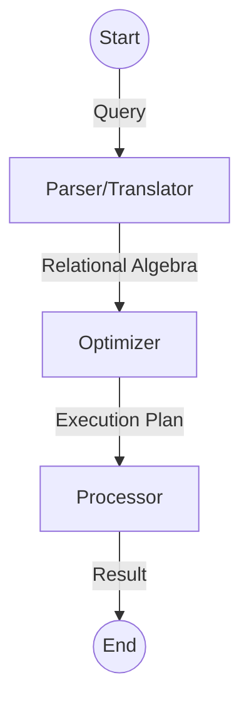

---
tags:
  - database
  - query-processing
  - relational-algebra
  - sql
---
Date: 2024-06-12 : 00:40
***

## Query Processing

## Relational Algebra
### Operations

| Symbol    | Name              |
| --------- | ----------------- |
| $\sigma$  | SELECT            |
| $\pi$     | PROJECT           |
| $\bowtie$ | INNER JOIN        |
| $\rtimes$ | SEMI JOIN         |
| $\times$  | CARTESIAN PRODUCT |

### Complexities
| Operation                             | Complexity          |
| ------------------------------------- | ------------------- |
| $\sigma$, $\pi$ (con duplicados)      | $O(n)$              |
| $\pi$ (sin duplicados), GROUP         | $O(n\cdot \log(n))$ |
| $\Join$, $\div$, $\cup$, $\cap$ y $-$ | $O(n\cdot \log(n))$ |
| $\times$                              | $O(n^2)$            |
